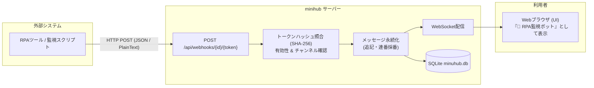

# Incoming Webhook（外部通知受信）機能 実装計画書

## Goal Description
RPAツールの実行結果（終了・エラー等）をはじめ、サーバ監視ツール（Zabbix等）、CI/CDパイプライン、バッチスクリプトなどの外部システムから、特定のチャンネルへ安全にメッセージを自動投稿できる **Incoming Webhook** 機能を minihub に導入します。

本機能により、外部システム連携をブラウザログインセッションなしで実現しつつ、厳格なトークン検証・権限スコープ分離・なりすまし防止・DoS保護を両立させます。

---

## 外部通知の利用イメージとワークフロー



---

## User Review Required

> [!IMPORTANT]
> **トークンの安全性に関する設計方針**
> 1. **平文トークンの非保持**: 生成されたWebhookトークン（64文字の16進数乱数 / 256bit）は、データベースには **SHA-256ハッシュのみ** を保存します。データベースのバックアップが外部に漏洩した場合でも、平文トークンは復元できません。
> 2. **トークンのワンタイム表示**: トークン（およびWebhook URL）は作成時および再生成時に **1度だけ** UI上に表示されます。以降は再表示できないため、安全にコピーして保管していただきます（GitHub PATやSlack Webhook等と同様の標準的な運用）。
> 3. **失効と再生成**: 漏洩時や利用停止時は、UIからワンクリックで「無効化（一時停止）」または「トークン再生成（旧トークンの即時失効）」が可能です。

> [!NOTE]
> **認証形式のハイブリッド対応**
> 外部システムの多様性（cURL、PowerShell、Python、ノーコードツール、SaaS等）に対応するため、以下の2方式のどちらでも認証可能とします：
> - **URLパス形式**: `POST /api/webhooks/{id}/{token}`
> - **Bearerヘッダー形式**: `POST /api/webhooks/{id}` （`Authorization: Bearer <token>` または `X-Webhook-Token: <token>`）

---

## Open Questions

> [!IMPORTANT]
> 実装に着手するにあたり、以下の設計選択についてご意見やご要望があればお知らせください：
> 1. **Slack互換ペイロードの受容**:
>    - 基本形式 `{"text": "メッセージ内容"}` のほか、Slack Incoming Webhookを想定した既存スクリプトやツールからの移行が容易になるよう、Slack形式のJSONを自動解釈して本文を抽出できるようにする方針で問題ないでしょうか？
> 2. **Webhookの作成権限**:
>    - 「チャンネル管理者（マネージャー）」および「システム管理者（Admin）」が作成できる仕様（チャンネル管理モーダル内のタブとして提供）を想定しています。一般ユーザーにも作成を許可すべきチャンネルはありますか？（推奨：乱立とセキュリティの観点から管理者/マネージャー限定）
> 3. **スレッド返信のサポート**:
>    - Webhookリクエストに任意で `threadRootSeq`（スレッドの親メッセージ番号）を指定できるようにし、特定スレッドへの追記通知を可能にする予定です。

---

## Proposed Changes

### 1. ドメイン層 (`internal/domain/models.go`)
#### [MODIFY] `internal/domain/models.go`
- Webhook定義エンティティ `Webhook` を追加
- Webhook投稿者情報 `WebhookMessageInfo` を追加
- `Message` 構造体に `Webhook *WebhookMessageInfo` を追加

```go
type Webhook struct {
    Version     int        `json:"version"`
    ID          string     `json:"id"`                    // 一意なID (例: "whk_0123456789abcdef")
    ChannelID   string     `json:"channelId"`             // 投稿先チャンネルID
    Name        string     `json:"name"`                  // 送信者表示名 (例: "経理RPAボット")
    Description string     `json:"description,omitempty"` // 用途説明
    TokenHash   string     `json:"tokenHash"`             // SHA-256ハッシュ
    Enabled     bool       `json:"enabled"`               // 有効/無効フラグ
    CreatedBy   string     `json:"createdBy"`             // 作成ユーザーID
    CreatedAt   time.Time  `json:"createdAt"`
    LastUsedAt  *time.Time `json:"lastUsedAt,omitempty"`  // 最終利用日時
}

type WebhookMessageInfo struct {
    ID   string `json:"id"`
    Name string `json:"name"`
}
```

---

### 2. ストレージ層 (`internal/storage/`)
#### [MODIFY] `internal/storage/storage.go`
- `Storage` インターフェースにWebhook関連のメソッドを定義：
  - `ListWebhooks(ctx context.Context, channelID string) ([]domain.Webhook, error)`
  - `GetWebhook(ctx context.Context, id string) (*domain.Webhook, error)`
  - `GetWebhookByTokenHash(ctx context.Context, tokenHash string) (*domain.Webhook, error)`
  - `CreateWebhook(ctx context.Context, wh domain.Webhook) error`
  - `UpdateWebhook(ctx context.Context, wh domain.Webhook) error`
  - `DeleteWebhook(ctx context.Context, id string) error`
  - `TouchWebhookUsed(ctx context.Context, id string, at time.Time) error`

#### [MODIFY] `internal/storage/sqlitestore/store.go`
- SQLiteマイグレーション（`user_version = 8`）を追加：
  ```sql
  CREATE TABLE IF NOT EXISTS webhooks(
      id TEXT PRIMARY KEY,
      channel_id TEXT NOT NULL,
      token_hash TEXT NOT NULL UNIQUE,
      data TEXT NOT NULL CHECK(json_valid(data))
  );
  CREATE INDEX IF NOT EXISTS webhooks_channel ON webhooks(channel_id);
  ALTER TABLE messages ADD COLUMN webhook TEXT CHECK(webhook IS NULL OR json_valid(webhook));
  PRAGMA user_version = 8;
  ```

#### [MODIFY] `internal/storage/sqlitestore/messages.go`
- `messageColumns` に `webhook` を追加
- `scanMessage` で `m.Webhook` の復元処理を追加
- `insertMessage` で `m.Webhook` のJSONシリアライズとカラム保存を追加

#### [NEW] `internal/storage/sqlitestore/webhooks.go`
- WebhookのCRUD・トークンハッシュ検索・最終利用日時更新の実装

---

### 3. サービス層 (`internal/service/`)
#### [NEW] `internal/service/webhook.go`
- Webhookの管理ビジネスロジック：
  - `ListWebhooks`: 権限確認（マネージャー/Admin）の上、チャンネルのWebhook一覧を取得
  - `CreateWebhook`: 暗号学的乱数（`crypto/rand`）でトークンを生成し、SHA-256ハッシュを計算して保存。生成した生トークンを返却
  - `UpdateWebhook`: 表示名・説明・有効状態の更新
  - `RegenerateWebhookToken`: 新トークンを生成しハッシュを更新、新トークンを返却（旧トークンは即時無効）
  - `DeleteWebhook`: Webhookを削除
- メッセージ受信ロジック：
  - `PostWebhookMessage(ctx context.Context, webhookID, rawToken, text string, threadRootSeq int64)`:
    - トークンのハッシュを計算し、`webhookID` およびハッシュで照合
    - 有効状態（`Enabled`）およびチャンネルのアーカイブ状態を検証
    - メッセージサイズ制限（`MaxMessageBytes`）チェック
    - メッセージ永続化（`storage.AddMessage`）：
      - `UserID: webhook.ID`
      - `Webhook: &domain.WebhookMessageInfo{ID: webhook.ID, Name: webhook.Name}`
      - `Text: text`
      - `ThreadRootSeq: threadRootSeq`
    - WebSocket通知イベント配信（`s.publisher.NewMessage`）
    - Webhookの `LastUsedAt` を非同期または短時間トランザクションで更新
    - レートリミット（1Webhookあたり毎秒5回、毎分60回超過時は 429 Too Many Requests）

---

### 4. HTTP API層 (`internal/httpapi/`)
#### [MODIFY] `internal/httpapi/httpapi.go`
- ルーティングの追加：
  1. **外部受信用エンドポイント**:
     - `POST /api/webhooks/{id}/{token}`
     - `POST /api/webhooks/{id}`（ヘッダー認証：`Authorization: Bearer <token>` または `X-Webhook-Token: <token>`）
     - セッション認証をバイパスし、トークン検証で認可
     - ボディは JSON（`{"text": "...", "threadRootSeq": 0}`）または `text/plain` に対応
  2. **管理用エンドポイント**:
     - `GET /api/channels/{channelId}/webhooks`
     - `POST /api/channels/{channelId}/webhooks`
     - `PUT /api/channels/{channelId}/webhooks/{id}`
     - `POST /api/channels/{channelId}/webhooks/{id}/regenerate`
     - `DELETE /api/channels/{channelId}/webhooks/{id}`
     - 既存のセッション認証・CSRF保護を適用

---

### 5. フロントエンド (`web/`)
#### [MODIFY] `web/index.html`
- チャンネル管理モーダル（`channelManagementModal`）のタブに「Webhook」を追加
- Webhook一覧パネル、作成ボタン、作成モーダル/フォームを追加
- 作成・再生成時の「Webhook URLコピー画面（警告付き）」モーダルを追加

#### [MODIFY] `web/js/app.js`
- `messageAuthor(message)` の拡張：
  ```javascript
  function messageAuthor(message) {
      if (message.ai) return `🤖 ${message.ai.name}`;
      if (message.webhook) return `🤖 ${message.webhook.name}`;
      return S.directory?.get(message.userId) || message.userId;
  }
  ```
- チャンネル管理画面内での Webhook タブのレンダリング、作成・編集・有効無効切り替え・トークン再生成・削除の処理を実装

#### [MODIFY] `web/css/app.css`
- Webhook一覧、トークン表示用コードブロック、コピー用ボタンのスタイリングを追加

---

## Verification Plan

### Automated Tests
1. **ストレージ層テスト (`internal/storage/sqlitestore/webhooks_test.go`)**:
   - Webhook作成、取得、ハッシュによる検索、更新、削除、最終利用日時の更新テスト
   - `user_version = 8` へのスキーママイグレーションテスト
   - メッセージ保存時の `webhook` カラム保存と復元テスト
2. **サービス層テスト (`internal/service/webhook_test.go`)**:
   - 認可チェック（マネージャー/管理者のみ作成・管理可能）
   - トークン生成とハッシュ照合の整合性
   - Webhookからのメッセージ投稿、連番（`seq`）採番、WebSocket通知配信
   - 無効化されたWebhookやアーカイブ済みチャンネルへの投稿拒否テスト
   - レートリミット（連投制限）の動作テスト
3. **HTTP APIテスト (`internal/httpapi/webhook_test.go`)**:
   - `POST /api/webhooks/{id}/{token}` の正常系（JSON、プレーンテキスト）
   - `Authorization: Bearer <token>` ヘッダーによる認証テスト
   - 不正なトークンでの 401 Unauthorized
   - チャンネル管理API経由での作成、生トークン返却、再生成、削除テスト
4. **統合テスト**:
   - `go test ./...`
   - `go vet ./...`

### Manual Verification
1. **Webhook作成とURL取得**:
   - ブラウザで管理者またはチャンネルマネージャーとしてログイン
   - チャンネル管理モーダルを開き、「Webhook」タブへ移動
   - 「Webhookを作成」で名前「RPA通知ボット」を入力して作成
   - 表示されたWebhook URLとcURLコマンド例を確認してコピー
2. **外部からの通知送信 (cURL / PowerShell)**:
   - ターミナルから cURL コマンドを実行：
     ```sh
     curl -X POST -H "Content-Type: application/json" -d '{"text": "RPA処理が正常に完了しました (処理件数: 42件)"}' "http://localhost:8080/api/webhooks/whk_xxx/token_yyy"
     ```
   - 画面リロードなしで、リアルタイムにチャット画面に「🤖 RPA通知ボット」としてメッセージが表示されることを確認
   - 未読バッジが他のログイン中ユーザーに正しく反映されることを確認
3. **セキュリティと失効検証**:
   - WebhookをUI上で「無効」に切り替えた後、同じcURLを実行して 401/403 で拒否されることを確認
   - 「トークン再生成」を行い、旧URLでは拒否され、新URLで送信できることを確認
   - 別のチャンネルのメッセージを読み取ろうとするリクエストが拒否されることを確認
