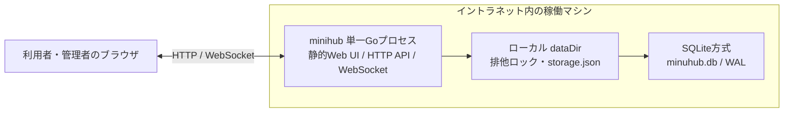
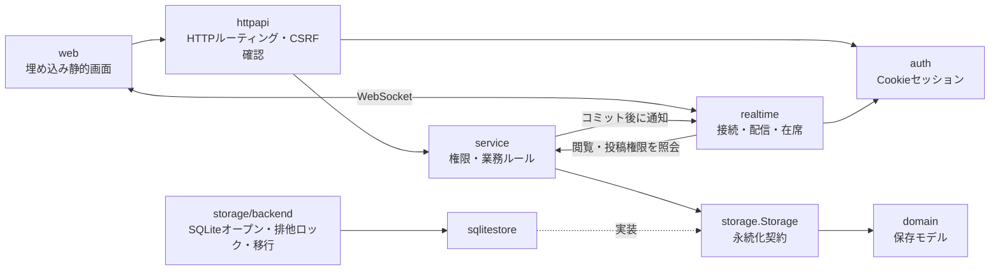
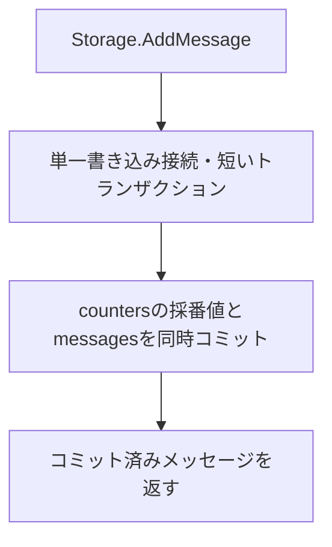

# アーキテクチャ

[設計図の目次](README.md) / [データモデル](data-model.md) / [処理フロー](workflows.md)

## 配置

永続化は組み込みSQLiteを使用します。外部DBサーバーはありません。データディレクトリのプロセス排他ロック（`.minihub.lock`）を取得し、安全に動作します。旧バージョンのfile方式データが存在する場合は、`minihub migrate -to sqlite` で移行します。

## コンポーネントと責務

`cmd/minihub` が設定を読み、ストレージ・初期管理者・サービス・HTTP・WebSocket を組み立てます。HTTP更新要求はセッション認証とCSRF確認を経て、サービス層で権限を判定します。非公開チャンネルの閲覧・投稿可否はサーバー側で判定し、WebSocket配信時にも閲覧権限を確認します。

保存処理が成功した後に、WebSocketはチャンネルIDや連番などの軽量イベントを配信します。クライアントは必要な本文や集計をHTTP APIから取得します。通常終了ではHTTP受付を止め、WebSocket接続を閉じてからストレージを閉じます。

## ストレージの書き込みと復旧

SQLite方式は永続索引を使い、採番値を `counters` テーブルに安全に保持します。WALモードにより読み書きが分離され、高速かつ堅牢に動作します。

## フロントエンド依存

Web画面、Bootstrap、Bootstrap Icons、faviconはGoの実行ファイルへ埋め込まれています。ビルド後の別途配置やCDN接続は不要です。

- Bootstrap 5.3.8
- Bootstrap Icons 1.13.1

配布用のCSS、JavaScript、SVG spriteとライセンスを `web/vendor/` に同梱しています。実行時にnpmやインターネット接続は使用しません。
