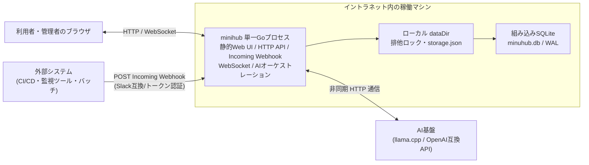
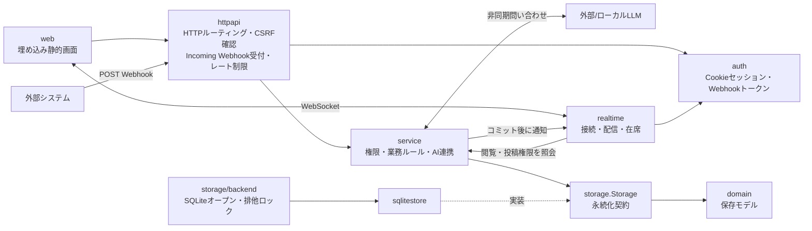
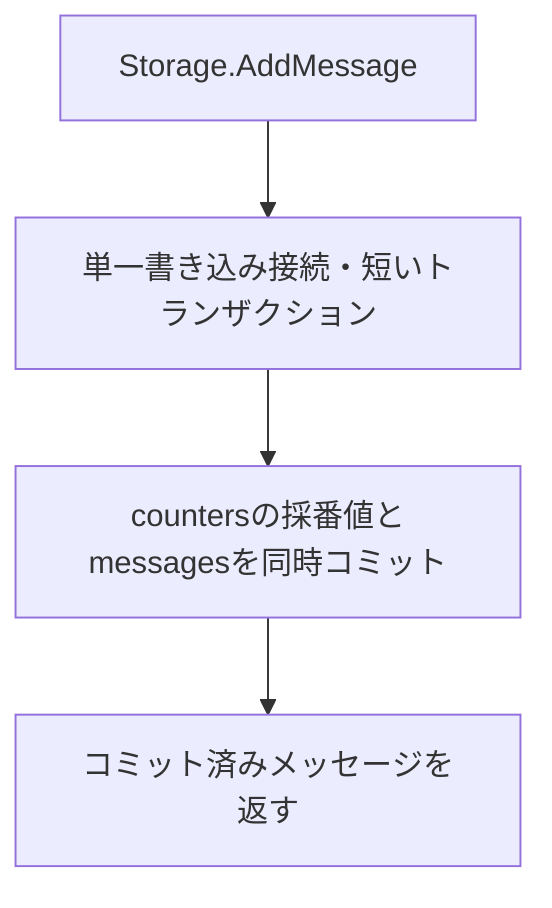

# アーキテクチャ

[設計図の目次](README.md) / [データモデル](data-model.md) / [処理フロー](workflows.md)

## 配置

永続化は組み込みSQLiteを使用します。外部DBサーバーはありません。データディレクトリのプロセス排他ロック（`.minihub.lock`）を取得し、安全に動作します。

## コンポーネントと責務

`cmd/minihub` が設定を読み、ストレージ・初期管理者・サービス・HTTP・WebSocket を組み立てます。

- **チーム対話**: HTTP更新要求はセッション認証とCSRF確認を経て、サービス層で権限を判定します。非公開チャンネルの閲覧・投稿可否はサーバー側で判定し、WebSocket配信時にも閲覧権限を確認します。
- **外部システム連携（Incoming Webhook）**: `httpapi` のWebhookハンドラがトークン認証とレート制限（1秒5件・1分60件）を行い、Slack互換ペイロードやプレーンテキストをメッセージ形式へ変換してサービス層へ渡します。スレッド返信指定（`threadRootSeq`）も解釈します。
- **AI協調**: サービス層が `@ai:` メンションを検知すると、スレッド履歴およびインメモリ添付ファイルを組み立てて外部LLM APIへ非同期リクエストを送信します。AIの回答を受信後、呼び出し元スレッドへ自動的に返信として永続化・リアルタイム配信します。
- **リアルタイム配信**: 保存処理が成功した後に、WebSocketはチャンネルIDや連番などの軽量イベントを接続中クライアントへ配信します。クライアントは必要な本文や集計をHTTP APIから取得します。通常終了ではHTTP受付を止め、WebSocket接続を閉じてからストレージを閉じます。

## ストレージの書き込みと復旧

SQLite方式は永続索引を使い、採番値を `counters` テーブルに安全に保持します。WALモードにより読み書きが分離され、高速かつ堅牢に動作します。

## フロントエンド依存

Web画面、Bootstrap、Bootstrap Icons、faviconはGoの実行ファイルへ埋め込まれています。ビルド後の別途配置やCDN接続は不要です。

- Bootstrap 5.3.8
- Bootstrap Icons 1.13.1

配布用のCSS、JavaScript、SVG spriteとライセンスを `web/vendor/` に同梱しています。実行時にnpmやインターネット接続は使用しません。

## スタイルシートの構成

全ページは最初に `web/css/layers.css` を読み込み、CSSカスケードレイヤーの優先順位を宣言します。後のレイヤーはセレクターの詳細度に関係なく前のレイヤーに優先するため、上書きに `!important` を使いません。

| レイヤー | ファイル | 内容 |
| --- | --- | --- |
| `base` | `app.css`、`schedule.css` の一部 | `*`、フォーム要素の `font: inherit`、`:disabled` など要素単位の初期化 |
| `bootstrap` | `vendor/bootstrap/bootstrap.min.css`（`layers.css` から読み込み） | Bootstrap本体 |
| `tokens` | `dads-tokens.css`、`theme.css` | デジタル庁デザインシステム（DADS）と画面共通のデザイントークン |
| `dads` | `dads-components.css` | フォーム、ボタン、モーダル、表、管理画面などのDADSコンポーネント |
| `app` | `app.css`、`chat.css`、`threads.css`、`polls.css`、`schedule.css` | チャット、スレッド、アンケート、予定調整などの画面固有の表示 |

DADSはBootstrapのCSS変数（`--bs-btn-border-radius`、`--bs-border-radius`、`--bs-danger-rgb` など）を通じて適用し、入力グループやボタングループの角丸処理をBootstrapに任せます。`app` レイヤーで下位レイヤーの値に戻す場合は `revert-layer` を使います。
